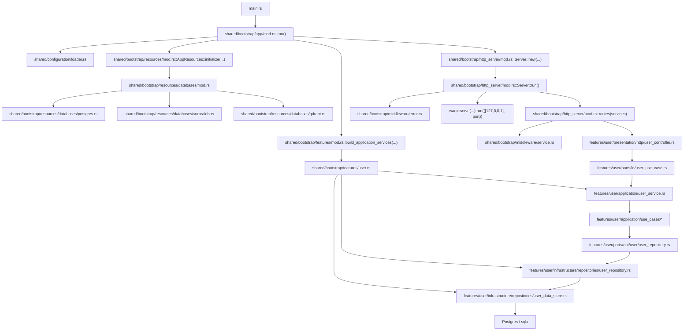
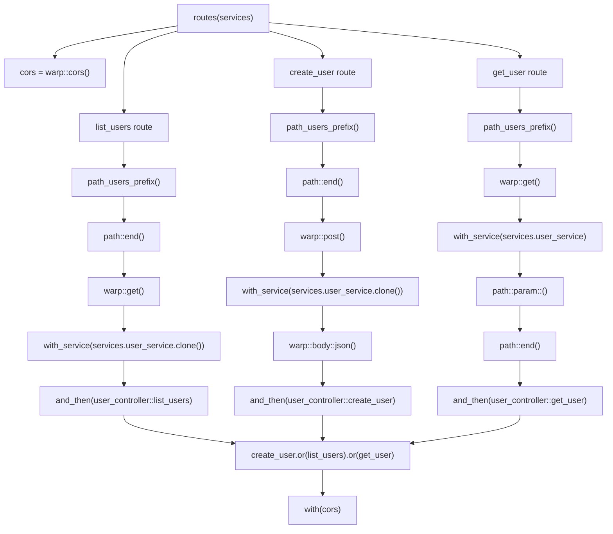
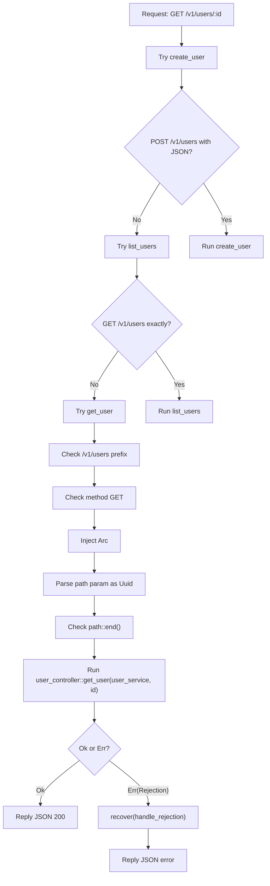

# Bootstrap Mental Map

Este archivo existe para mirar `shared/bootstrap` como un mapa de conexiones.

La idea central de esta capa es:

```text
No contiene logica de negocio.
Contiene composicion, conexion y arranque.
```

## Mapa General



## Lectura En Una Frase

```text
main prende la app,
bootstrap la arma,
http_server publica rutas,
controllers entran por ports/in,
application usa ports/out,
infrastructure habla con la DB.
```

## Paso A Paso Del Arranque

### 1. `main.rs`

`main` no contiene negocio.

Solo:

```text
- crea runtime Tokio;
- llama a bootstrap::app::run().
```

Eso deja `main` limpio.

### 2. `app/mod.rs`

`shared/bootstrap/app/mod.rs` es el orquestador principal.

Orden real:

1. `load_configuration()`
2. `AppResources::initialize(&config)`
3. `build_application_services(&resources)`
4. parsea `server.port`
5. `Server::new(port, services)`
6. `server.run().await`

Mentalmente:

```text
configuration -> resources -> feature services -> http server
```

`app/mod.rs` no crea conexiones directas ni instancia repositorios concretos.
Solo coordina constructores especializados.

## Mapa De `resources`

`resources` representa recursos tecnicos compartidos por la aplicacion.

Hoy contiene:

```text
AppResources
└── DatabaseResources
    ├── postgres
    ├── surrealdb
    └── qdrant
```

Cada proveedor de base de datos tiene su propio archivo:

```text
resources/databases/postgres.rs
resources/databases/surrealdb.rs
resources/databases/qdrant.rs
```

Asi las conexiones, health checks y migraciones no crecen dentro de `app/mod.rs`.

## Mapa De `features`

`features` arma los servicios de aplicacion que seran usados por HTTP.

Hoy contiene:

```text
features/user.rs
```

`user.rs` define su contrato de dependencias de bootstrap:

```text
UserFeatureDependencies
└── DbPool
    └── UserDataStore -> UserRepository -> UserService -> Arc<dyn IUserUseCase>
```

A futuro otra feature puede pedir otra combinacion:

```text
product -> Postgres + Qdrant
auth -> Clerk/Firebase
email -> Resend/SMTP
```

La firma del constructor de la feature queda estable:

```rust
build_user_service(UserFeatureDependencies)
```

Si `user` necesita mas recursos despues, se agregan al struct de dependencias
de `user`, no como una lista larga de parametros sueltos.

## Mapa Del Objeto `Services`

`Services` es el nombre publico usado por HTTP.

Internamente es un alias/re-export de `ApplicationServices`, definido en:

```text
shared/bootstrap/features/mod.rs
```

Hoy contiene:

```rust
pub struct ApplicationServices {
    pub user_service: Arc<dyn IUserUseCase>
}
```

Lectura mental:

```text
HTTP no conoce UserService concreto.
HTTP conoce el puerto de entrada IUserUseCase.
```

Ese detalle importa porque presentation depende del contrato, no de la implementacion concreta.

## Paso A Paso Dentro De `Server::run()`

Codigo mental:

```rust
pub async fn run(&self) {
    let routes =
        routes(self.services.clone())
            .recover(middleware::error::handle_rejection);

    warp::serve(routes).run(([127, 0, 0, 1], self.port)).await;
}
```

### 1. `self.services.clone()`

`run(&self)` solo tiene una referencia al `Server`.

Por eso no puede mover `self.services`.

Entonces clona `Services`.

Como `Services` contiene `Arc<dyn IUserUseCase>`, ese clone es barato:

```text
no duplica toda la app;
solo incrementa el contador del Arc.
```

### 2. `routes(...)`

Construye el filtro principal de Warp.

Todavia no levanta servidor real.

Solo describe:

```text
que rutas existen,
que path aceptan,
que metodo aceptan,
que dependencias inyectan,
que controller ejecutan.
```

### 3. `.recover(handle_rejection)`

Le dice a Warp:

```text
si alguna ruta devuelve Rejection,
convierte ese rechazo en una respuesta HTTP controlada.
```

Aqui vive la traduccion:

```text
CustomError::HttpError         -> 400
BodyDeserializeError           -> 400
UnsupportedMediaType           -> 415
MethodNotAllowed               -> 405
not_found                      -> 404
DatabaseError / HashError      -> 500
```

### 4. `warp::serve(routes)`

Warp toma la descripcion de rutas y crea un servidor HTTP real.

### 5. `.run(([127,0,0,1], self.port))`

El servidor escucha en:

```text
127.0.0.1 = localhost
self.port = puerto leido desde configuracion
```

Ejemplo:

```text
127.0.0.1:8080
```

## Paso A Paso Dentro De `routes(services)`

La funcion `routes(...)` conecta casi toda la parte HTTP.

Firma mental:

```rust
pub fn routes(services: Services)
    -> impl Filter<Extract = (impl Reply,), Error = Rejection> + Clone
```

Lectura:

```text
devuelve un filtro clonable de Warp;
si matchea la request produce una respuesta HTTP;
si falla produce un Rejection.
```

## Diagrama Interno De `routes(...)`



## Que Hace Cada Pieza

### `path_users_prefix()`

Devuelve:

```rust
path!("v1" / "users" / ..).boxed()
```

Lectura:

```text
la ruta debe empezar con /v1/users
y puede seguir con mas segmentos.
```

No extrae datos.
Solo valida prefijo comun.

### `path::end()`

Lectura:

```text
la ruta debe terminar aqui.
```

Por eso `GET /v1/users` entra en `list_users`, pero `GET /v1/users/123` no.

### `warp::get()` / `warp::post()`

Filtran por metodo HTTP.

### `with_service(...)`

Inyecta el servicio en la ruta.

Hoy mete:

```text
Arc<dyn IUserUseCase>
```

Eso significa que el controller recibira el puerto de entrada ya listo.

### `warp::body::json()`

Lee el body y lo deserializa.

En `create_user` termina produciendo:

```text
CreateUserDto
```

### `path::param::<Uuid>()`

Lee el siguiente segmento del path y trata de convertirlo a `Uuid`.

En `get_user` produce:

```text
Uuid
```

### `and_then(user_controller::...)`

Aqui los filtros anteriores ya extrajeron todo.

Warp toma esos valores y los pasa al controller en el mismo orden en que fueron extraidos.

## Orden Real De Extraccion

Esto es importante.

### `list_users`

```rust
path_users_prefix()
    .and(path::end())
    .and(warp::get())
    .and(with_service(...))
    .and_then(user_controller::list_users)
```

Extraccion final antes del controller:

```text
(Arc<dyn IUserUseCase>,)
```

Entonces Warp llama:

```rust
list_users(user_service)
```

### `create_user`

```rust
path_users_prefix()
    .and(path::end())
    .and(warp::post())
    .and(with_service(...))
    .and(warp::body::json())
    .and_then(user_controller::create_user)
```

Extraccion final:

```text
(Arc<dyn IUserUseCase>, CreateUserDto)
```

Entonces Warp llama:

```rust
create_user(user_service, body)
```

### `get_user`

```rust
path_users_prefix()
    .and(warp::get())
    .and(with_service(...))
    .and(path::param::<Uuid>())
    .and(path::end())
    .and_then(user_controller::get_user)
```

Extraccion final:

```text
(Arc<dyn IUserUseCase>, Uuid)
```

Entonces Warp llama:

```rust
get_user(user_service, id)
```

## Por Que El Orden De Los Filtros Importa

Porque Warp construye argumentos en secuencia.

Si cambiaras:

```rust
.and(with_service(...))
.and(path::param::<Uuid>())
```

por:

```rust
.and(path::param::<Uuid>())
.and(with_service(...))
```

entonces la extraccion quedaria:

```text
(Uuid, Arc<dyn IUserUseCase>)
```

y ya no coincidiria con la firma del controller:

```rust
get_user(user_service, id)
```

## Que Hace `or(...)`

```rust
create_user.or(list_users).or(get_user)
```

Lectura:

```text
prueba una ruta;
si rechaza, prueba la siguiente;
si rechaza, prueba la siguiente.
```

No ejecuta todos los handlers.

Solo ejecuta el handler de la primera rama que matchea de verdad.

## Diagrama De Una Request Real

Ejemplo:

```text
GET /v1/users/550e8400-e29b-41d4-a716-446655440000
```



## Conexiones Entre Capas

### Desde HTTP hacia Application

`user_controller.rs` depende de:

```text
IUserUseCase
```

No depende de `UserService` concreto.

Eso mantiene a presentation conectada al puerto, no a la implementacion.

### Desde Application hacia Infrastructure

`UserService` y `use_cases` dependen de:

```text
IUserRepository
```

No conocen SQLx ni Postgres.

### Quien Conecta Todo

`app.rs` hace esta union:

```text
UserDataStore -> UserRepository -> UserService -> Arc<dyn IUserUseCase> -> Server
```

Bootstrap conecta.
Las capas internas no se crean unas a otras.

## Resumen Final

Si quieres recordar bootstrap en una sola imagen mental:

```text
app.rs arma objetos concretos;
http_server.rs arma el pipeline HTTP;
middleware corrige errores e inyecta servicios;
controllers entran por ports/in;
application usa ports/out;
repositories y datastore hablan con la DB.
```

O todavia mas corto:

```text
bootstrap conecta,
presentation recibe,
application decide,
infrastructure ejecuta.
```
