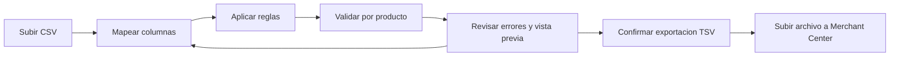
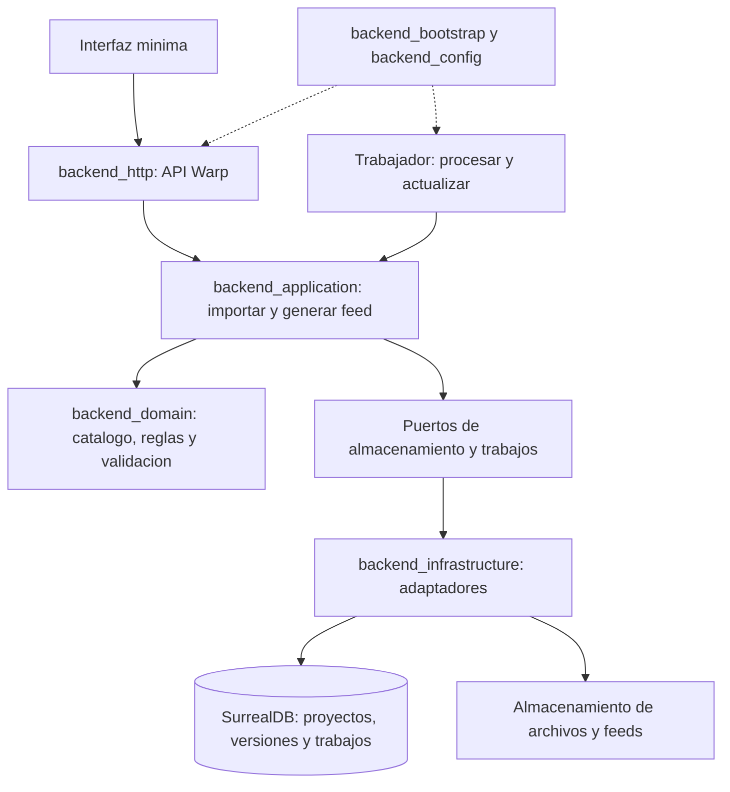

# 03 — Fases y diagramas de construcción

Fecha de creación: 2026-10-12  
Estado: Plan.  
Relacionado: [producto](./01-producto-y-prototipo.md), [prioridades](./02-prioridades-y-dificultad.md), [evidencia](./04-fuentes-y-validacion.md).

## Punto de partida real

El backend tiene siete crates, casos de uso de usuarios y puertos. El servidor actual usa **Warp**, según [Cargo.toml](../Cargo.toml); migrar a Axum no es requisito de este plan. No hay todavía importación de catálogos, reglas, feeds ni interfaz de producto. Crear usuarios tampoco equivale a tener autenticación y autorización completas.

**La persistencia del producto será SurrealDB.** Ya existe un cliente remoto y su comprobación de conexión. El repositorio de usuarios todavía utiliza PostgreSQL/SQLx y el arranque exige los tres proveedores: sustituir ese adaptador y retirar esa dependencia será el incremento 0. La migración está planificada, no ejecutada. Qdrant tendrá un arranque opcional y queda fuera del recorrido inicial. [Archivos y pasos concretos](./09-decisiones-y-plan-de-construccion.md).

## Recorrido del prototipo

Los errores bloqueantes impiden exportar el producto afectado. El usuario debe revisar y confirmar las exclusiones; no ocultaremos productos descartados ni inventaremos datos faltantes.

## Orden de construcción

| Fase | Qué construir | Criterio para avanzar |
| --- | --- | --- |
| 0. Base SurrealDB | Adaptador de usuarios, esquema versionado, composición y arranque usando SurrealDB. | Los casos de uso actuales funcionan y el servidor arranca sin exigir proveedores ajenos al recorrido. |
| A. Prototipo local | Proyecto local, catálogo, importación CSV, trabajo manual básico, mapeo, reglas predefinidas, validación, exportación y pantalla mínima. | Completar el recorrido con un catálogo de un usuario piloto y obtener un TSV que Merchant Center pueda procesar. |
| B. Primer piloto comercial | Autenticación, propiedad de proyectos, aislamiento entre clientes, trabajos persistentes, fuente CSV por URL, actualización diaria, URL del feed y alertas en el panel. Configuración asistida y cobro manual. | Un cliente paga y completa al menos dos ciclos de actualización; un fallo conserva la última publicación válida y muestra cuándo se generó. |
| C. Herramientas de agencias | Varios proyectos, permisos, plantillas de reglas y un conector de tienda elegido por demanda. | Dos clientes requieren el mismo flujo; medir reducción de tiempo y coste de soporte. |
| D. Ampliación selectiva | Seguir el orden comercial 4–7 y desarrollar una capacidad cada vez. | Petición repetida y compromiso de pago; definir alcance y nueva evidencia antes de implementar. |

En A pondremos un límite inicial de 5.000 productos por importación para acotar pruebas; es una decisión de alcance, no una capacidad medida. En B, publicar un feed actualizado no significa que Google lo descargue o apruebe inmediatamente.

## Arquitectura propuesta sobre los crates actuales

Rust aportará control del uso de memoria y procesamiento por lotes. El [runtime actual](../src/main.rs) es de un solo hilo: el trabajo pesado deberá ejecutarse fuera del manejador HTTP, con concurrencia limitada. Mediremos memoria, duración y coste por importación; usar Rust por sí solo no demuestra una ventaja comercial.

## Comprobaciones previstas

Casos representativos: identificadores con ceros iniciales, CSV con comillas y saltos de línea, campos obligatorios ausentes, precio y moneda inválidos y reglas aplicadas en orden. En B añadiremos actualización de precio/stock, reintento sin duplicados, recuperación de trabajos e intento de acceso a otro cliente. La publicación debe ser atómica: un feed incompleto nunca sustituye al anterior.
