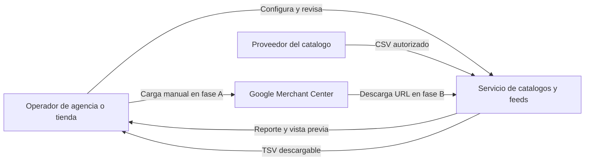
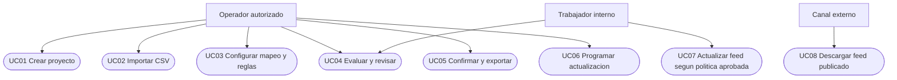
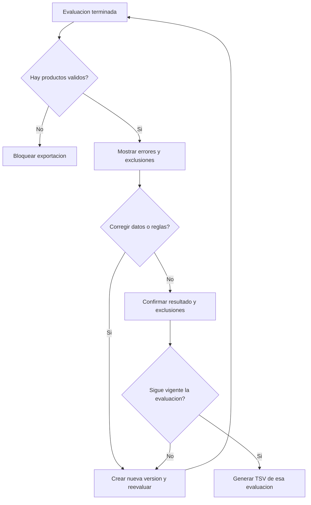

# 05 — Análisis del sistema y requisitos

Fecha de creación: 2026-10-12  
Estado: Diseño propuesto.  
Relacionado: [producto](./01-producto-y-prototipo.md), [dominio](./06-dominio-y-datos-surrealdb.md), [decisiones](./09-decisiones-y-plan-de-construccion.md).

## Contexto del sistema

Vista de contexto inspirada en C4: actores, sistema y dependencias externas. El cliente conserva su tienda; nosotros preparamos sus datos para un canal.

**Dentro del límite:** proyectos, importación, mapeo, reglas, evaluación, exportación y mantenimiento del feed. **Fuera:** modificar la tienda de origen, decidir presupuestos publicitarios, gestionar pedidos o garantizar ventas y aprobación del canal.

## Actores y permisos

En A trabaja un operador local con un proyecto. En B hay un propietario autenticado por organización. En C se incorporan colaboradores y roles: propietario administra miembros; editor configura y publica; lector consulta. Una organización representa al cliente que paga, y cada proyecto representa una tienda. Estos permisos deben verificarse en la aplicación, no solo en la interfaz.

## Casos de uso y requisitos funcionales

| ID | Requisito verificable | Fase |
| --- | --- | --- |
| RF01 / UC01 | Proyecto con país, moneda, perfil de canal y organización propietaria. | A |
| RF02 / UC02 | Importar CSV UTF-8 con columna identificadora elegida por el operador; conservar filas originales y rechazar IDs ausentes o duplicados. | A |
| RF03 / UC03 | Guardar mapeo y reglas como una versión; aplicarlas en orden definido. | A |
| RF04 / UC04 | Mostrar problemas por fila y contar productos válidos, inválidos y excluidos. | A |
| RF05 / UC05 | Exportar únicamente la evaluación revisada; confirmar las exclusiones y bloquear un feed vacío. | A |
| RF06 / UC06–08 | Programar una fuente autorizada, mantener URL estable y mostrar fecha, fallos y versión publicada. | B |
| RF07 | Comprobar identidad y pertenencia antes de consultar o modificar recursos de un cliente. | B |

Si una evaluación contiene filas inválidas, el operador puede corregirlas y generar otra evaluación, o confirmar expresamente su exclusión. Las exclusiones por reglas también aparecen en el resumen.

## Actividad de revisión

## Requisitos de calidad

| ID | Regla de diseño | Comprobación prevista |
| --- | --- | --- |
| RNF01 | Límites iniciales: 5.000 filas y 10 MiB de CSV por trabajo; propuesta de alcance. | Rechazo controlado del exceso; medir memoria y duración con el límite. |
| RNF02 | Un resultado identifica entrada, reglas, perfil del canal y versión del motor. | Repetir la evaluación y comparar contenido y conteos. |
| RNF03 | Un fallo no cambia el feed publicado; las tareas pesadas tienen concurrencia limitada. | Fallo durante generación y dos trabajos sobre el mismo feed. |
| RNF04 | Identificadores como texto y precios decimales con moneda explícita. | Ceros iniciales, decimales y separadores regionales. |
| RNF05 | Archivos privados salvo el feed habilitado; registros de operación sin credenciales ni catálogo completo. | Acceso cruzado, descarga no autorizada y revisión de logs. |

Los límites son configurables y deberán medirse antes de aumentar capacidad. Esta especificación define aceptación; no afirma que esas comprobaciones ya se hayan ejecutado.
