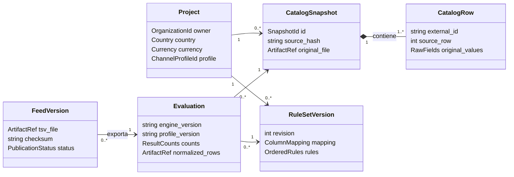
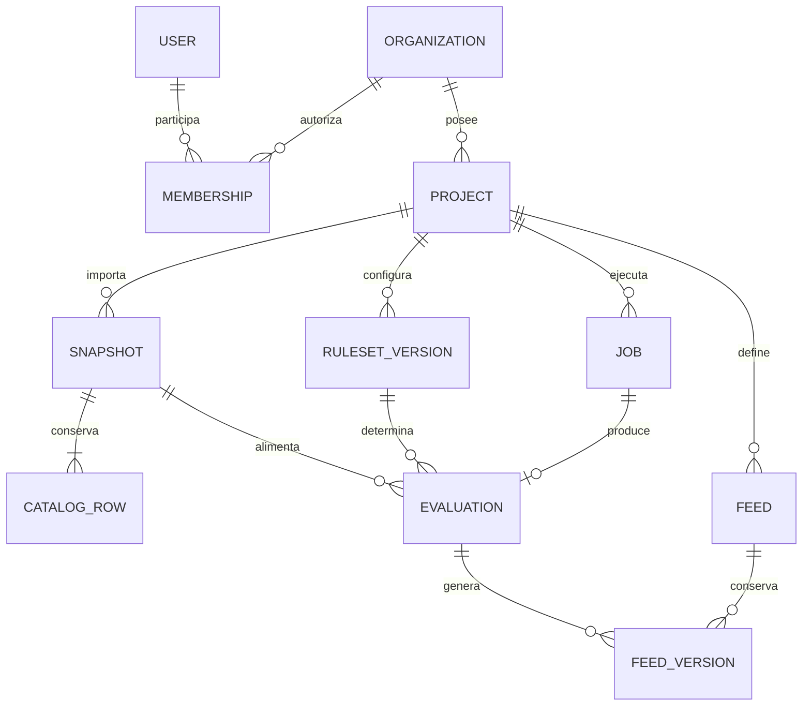

# 06 — Dominio y modelo de datos en SurrealDB

Fecha de creación: 2026-10-12  
Estado: Diseño lógico; todavía sin esquema ejecutable.  
Relacionado: [requisitos](./05-analisis-y-requisitos.md), [arquitectura](./07-arquitectura-y-contratos.md), [secuencias](./08-secuencias-y-estados.md).

## Conceptos y responsabilidades

Un monolito con tres módulos de negocio: **identidad y proyectos**, **catálogo y transformación**, **publicación y trabajos**. Son límites internos; no requieren microservicios. Un producto aquí es una fila del catálogo de una tienda, no una entidad global compartida entre clientes.

`CatalogSnapshot`, `RuleSetVersion` y `Evaluation` son versiones inmutables una vez completadas. Editar reglas crea otra versión; no altera resultados anteriores. La evaluación guarda las filas normalizadas y sus problemas en artefactos, con resumen en SurrealDB. Así podemos exportar exactamente lo revisado.

## Relaciones persistentes

Diagrama lógico de registros y enlaces. La notación ER expresa cardinalidades; no implica usar un motor relacional ni claves foráneas SQL.

En A se utiliza una organización local y un feed Google; membresías autenticadas y programación llegan en B. Un `job` del diagrama es trabajo de evaluación; la publicación es una operación separada. La fuente CSV remota se guarda en la configuración del proyecto en B, sin crear un módulo de conectores genérico.

## Diccionario mínimo

| Registro | Campos esenciales y restricciones |
| --- | --- |
| `project` | `organization`, país, moneda, perfil; se valida que sus referencias pertenezcan al propietario. |
| `snapshot` / `catalog_row` | Proyecto, columna identificadora elegida, hash, archivo original y estado; filas con `external_id` textual y valores originales. Único `(snapshot, external_id)`. |
| `ruleset_version` | Proyecto, revisión, mapeo y lista ordenada de reglas. Único `(project, revision)`. |
| `evaluation` | Proyecto, snapshot, reglas, versiones de perfil/motor, conteos y referencias a resultados e informe. |
| `feed` / `feed_version` | Proyecto, canal, `published_version`, generación y política aprobada; versiones con evaluación, archivo, checksum y fecha. |
| `job` | Proyecto, entrada, estado, clave de idempotencia, intentos, lease, token de ejecución y error público. |
| `user` / `organization` / `membership` | UUID público de usuario, organización y rol. Único `(organization, user)` en membresías. |

Las tablas tendrán campos definidos y validaciones de esquema; atributos variables se limitarán a objetos expresamente permitidos. Usaremos enlaces a registros y un solo namespace/database por entorno con aislamiento de organizaciones en la aplicación. Índices y consultas deben incluir el proyecto o propietario cuando corresponda. [Tablas e índices, E9–E10](./04-fuentes-y-validacion.md).

## Invariantes del dominio

1. Ninguna referencia mezcla proyectos u organizaciones: comprobarlo al crear y al usar el registro; un enlace no concede permiso.
2. La columna identificadora se fija al importar; las reglas iniciales no cambian IDs. Los precios usan una representación decimal exacta y moneda del proyecto; no `float`. No inferir automáticamente moneda o separador ambiguo.
3. `validos + invalidos + excluidos = total`. Una fila inválida no puede llegar al TSV.
4. Una evaluación queda vinculada a versiones concretas; aprobar una vista previa no aprueba una revisión posterior.
5. El feed apunta solo a un archivo completo y verificado. El cambio del puntero y el registro de publicación comparten transacción; los archivos quedan fuera de ella. [Transacciones, E11](./04-fuentes-y-validacion.md).

Los CSV/TSV y reportes viven en un almacenamiento de archivos detrás de un puerto; SurrealDB conserva metadatos y referencias. El dominio no conoce record IDs del SDK, SurrealQL, Warp ni rutas de disco. No añadiremos relaciones de grafo o búsquedas vectoriales sin un caso de uso que las necesite.
