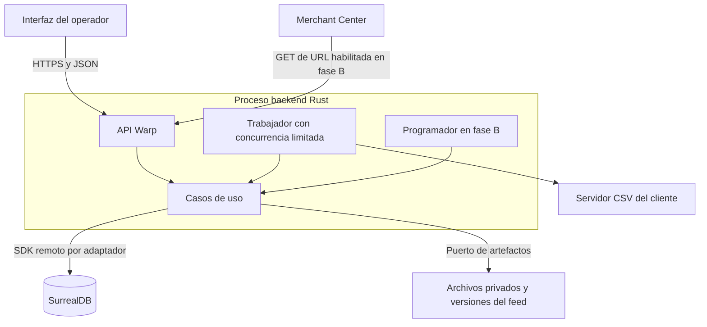
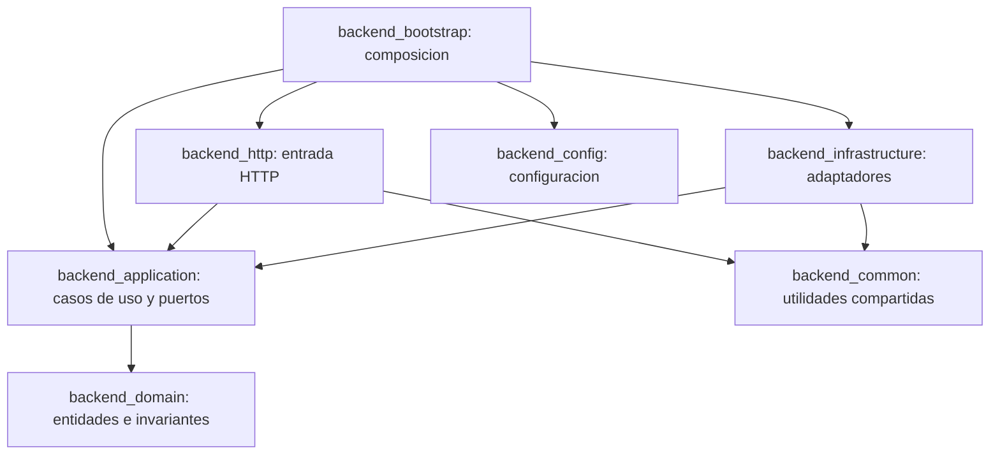

# 07 — Arquitectura y contratos

Fecha de creación: 2026-10-12  
Estado: Diseño objetivo.  
Relacionado: [dominio](./06-dominio-y-datos-surrealdb.md), [ejecución](./08-secuencias-y-estados.md), [construcción](./09-decisiones-y-plan-de-construccion.md).

## Vista de despliegue

Vista de contenedores inspirada en C4. Comenzamos con un proceso Rust que aloja API y trabajador; pueden separarse después usando los mismos contratos. SurrealDB opera como servidor remoto, aprovechando el cliente existente. La interfaz mínima aún no tiene framework elegido.

El almacenamiento local necesita volumen persistente; las copias deben cubrir tanto registros como archivos. Un almacenamiento de objetos podrá reemplazarlo mediante el puerto si el despliegue lo requiere. No se introduce otro servicio por anticipación.

## Dependencias del código

Las flechas indican dependencias de compilación, no el flujo de ejecución. Los adaptadores implementan puertos definidos en aplicación; la aplicación no depende de los adaptadores.

Las nuevas features se organizan dentro de los crates actuales por responsabilidad. `backend_common` no se convierte en depósito de reglas de negocio. La conexión SurrealDB y sus tipos permanecen en infraestructura; bootstrap compone las dependencias.

## Puertos propuestos

Contratos conceptuales; las firmas Rust finales se escribirán al implementar cada incremento. Todos reciben el contexto autorizado del proyecto y devuelven errores propios.

| Puerto | Operaciones mínimas | Responsabilidad del adaptador |
| --- | --- | --- |
| `CatalogRepository` | Guardar snapshot y filas, completar importación, leer por proyecto. | Persistir por lotes; no hacer visible un snapshot incompleto. |
| `RuleSetRepository` | Guardar y recuperar versión de mapeo/reglas. | Revisiones únicas y sin sobrescritura. |
| `EvaluationRepository` | Guardar y consultar resultado terminado. | Conservar entrada, versiones, conteos y artefactos. |
| `JobRepository` | Encolar, reclamar, renovar lease, terminar o reintentar. | Reclamo condicional y token que invalida a trabajadores antiguos. |
| `FeedRepository` | Preparar versión, publicar con generación esperada, leer versión vigente. | Transacción corta y control de concurrencia. |
| `ArtifactStore` | Guardar, finalizar, leer y retirar artefacto no referenciado. | Archivo completo antes de publicar; claves internas, no rutas aportadas por el usuario. |

`IUserRepository` se conserva durante la sustitución de persistencia. `ProjectAccess` y `CatalogSource` se incorporan en B para autorización y descarga controlada. No construiremos todos los traits antes de sus casos de uso.

## Contrato HTTP previsto

| Operación | Ruta propuesta | Retorno |
| --- | --- | --- |
| Importar | `POST /v1/projects/{id}/imports` | `202`, snapshot/job y URL de consulta. |
| Configurar | `POST /v1/projects/{id}/rulesets` | `201`, revisión creada. |
| Evaluar | `POST /v1/projects/{id}/evaluations` | `202`, job asociado a versiones explícitas. |
| Consultar | `GET /v1/projects/{id}/jobs/{job_id}` | Estado, progreso, resultado o error estable. |
| Revisar | `GET /v1/projects/{id}/evaluations/{evaluation_id}` | Conteos, muestra e informe paginado. |
| Exportar | `POST /v1/projects/{id}/exports` | Archivo TSV de una evaluación confirmada. |
| Publicar, B | `POST /v1/projects/{id}/feeds/{feed_id}/publications` | Versión publicada o conflicto de revisión. |
| Descargar, B | `GET /feeds/{delivery_token}.tsv` | Contenido de la versión vigente; nunca catálogo original. |

Los cuerpos grandes usan carga de archivo, no JSON con el catálogo entero. La URL de entrega utiliza un token opaco revocable, separado de la sesión del operador. Errores comunes: `400` formato de solicitud, `413` límite, `422` datos inválidos, `409` revisión/conflicto, `404` recurso ausente o inaccesible y `503` dependencia temporal. La respuesta incluye `code`, mensaje comprensible y `request_id`; el detalle técnico queda en logs.

HTTP valida transporte y contexto; aplicación coordina; dominio aplica reglas; infraestructura lee y guarda. Esta separación permite cambiar persistencia y verificar el procesamiento sin una base real, a costa de algunos mapeos y contratos adicionales.
