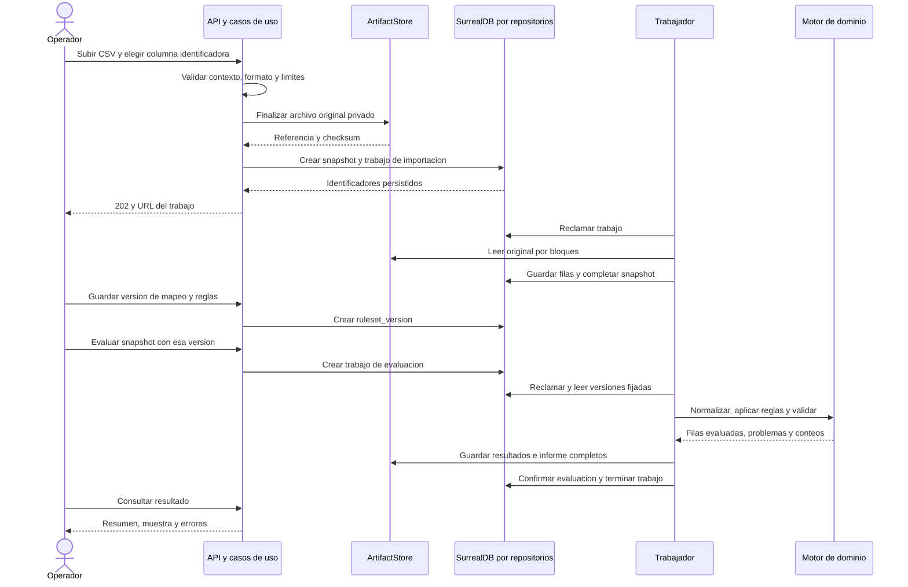
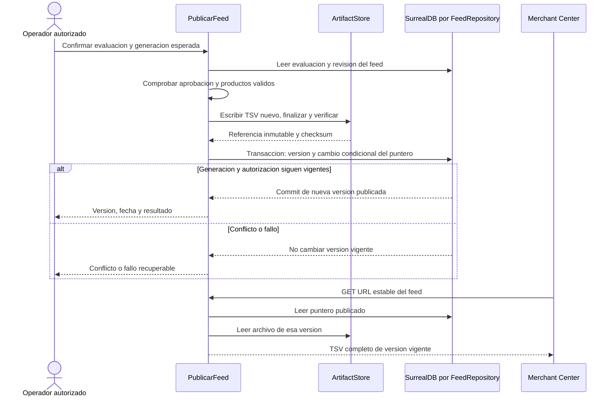
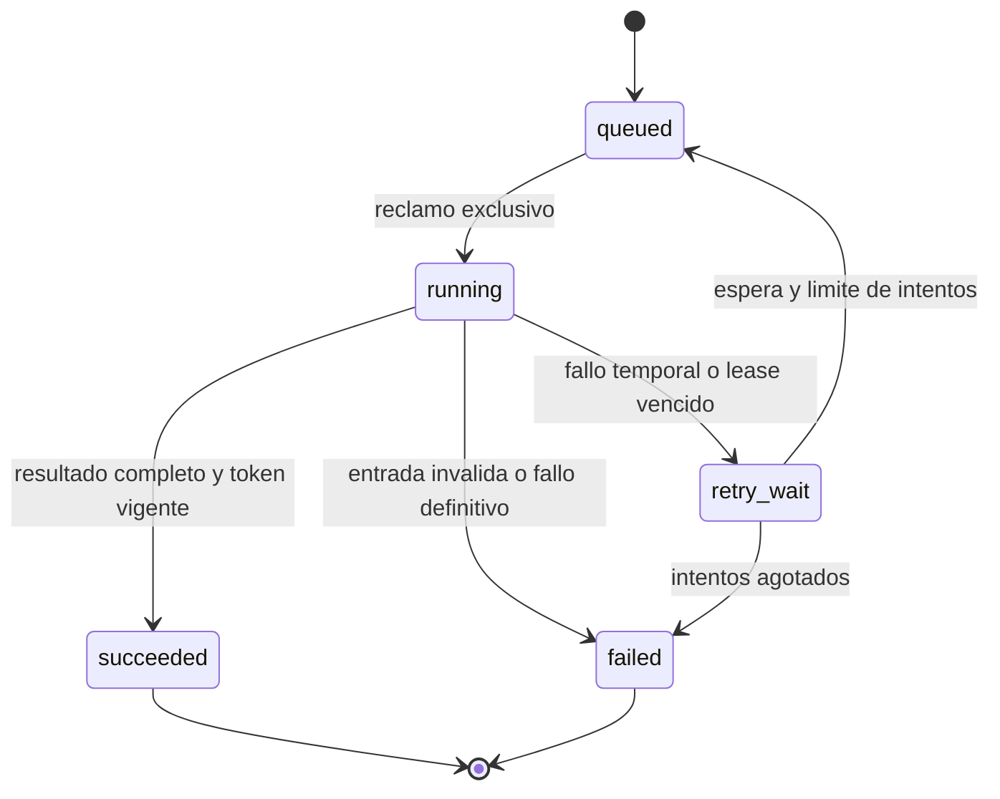

# 08 — Secuencias, estados y consistencia

Fecha de creación: 2026-10-12  
Estado: Diseño propuesto; recuperación avanzada en fase B.  
Relacionado: [requisitos](./05-analisis-y-requisitos.md), [datos](./06-dominio-y-datos-surrealdb.md), [contratos](./07-arquitectura-y-contratos.md).

## Importación y evaluación

Importar y evaluar son operaciones distintas: el operador define las columnas sobre una entrada ya conservada. En A habrá un trabajador local; B agrega recuperación tras reinicios y leases.

El snapshot solo pasa a `ready` cuando termina la importación y se comprueba unicidad de IDs. Un error de parseo o un duplicado lo deja `failed`, con informe y sin permitir evaluación. Si el archivo se guarda pero la creación de registros falla, queda un artefacto huérfano: una limpieza posterior verifica referencias antes de retirarlo.

## Publicación consistente

Secuencia objetivo de B. En A se genera el mismo archivo como descarga privada. La aprobación identifica la evaluación, checksum y exclusiones aceptadas.

Una transacción SurrealDB no incluye el disco ni un servidor externo. Por eso se finaliza el archivo antes de cambiar el puntero. Una lectura ya iniciada puede devolver la versión anterior completa; nunca mezcla dos versiones. El archivo previo se conserva mientras sea referenciado. [Transacciones, E11](./04-fuentes-y-validacion.md).

En B, la actualización automática requiere una política aprobada: versiones de reglas/perfil, exclusiones permitidas y límite de caída de productos. Si falla esa política, queda pendiente de revisión y se mantiene la publicación anterior. El umbral se acordará con el piloto; no será una cifra oculta.

## Ciclo de vida del trabajo

Cada reclamo tiene `lease_until` y un token de ejecución. El trabajador renueva el lease y solo puede terminar/publicar con el token vigente. Recuperar un trabajo invalida el token anterior. El procesamiento puede repetirse: **no prometemos ejecución exactamente una vez**, controlamos sus efectos mediante idempotencia y escritura condicional.

En B, una clave de idempotencia se limita a organización, proyecto y operación; repetirla con el mismo contenido devuelve el trabajo existente, y con contenido distinto produce conflicto. El programador usa una clave por ejecución prevista. Reintentos tienen espera creciente y máximo configurable; errores de datos requieren corrección, no reintentos automáticos.
