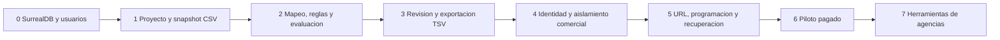

# 09 — Decisiones y plan de construcción

Fecha de creación: 2026-10-12  
Última actualización: 2026-10-17
Estado: Acuerdos de diseño y siguientes incrementos.  
Referencia de código: HEAD `260096f` con cambios locales existentes; este trabajo modifica documentación.  
Relacionado: [índice](./01-producto-y-prototipo.md), [análisis](./05-analisis-y-requisitos.md), [arquitectura](./07-arquitectura-y-contratos.md).

## Evolución del 2026-10-17

La entrada vigente para el backend es [02 — Simplificar y preparar auth](../docs/plans/02-simplificar-backend-y-preparar-auth.md).
El usuario pidió respaldar el estado actual, reducir la dispersión de los siete
crates y preparar Firebase Authentication con cuentas SurrealDB sin estados.
Los [planes de auth](../docs/plans/03-auth-firebase-surrealdb.md) y
[migraciones](../docs/plans/04-esquema-y-migraciones-surrealkit.md) preceden ahora
al recorrido de catálogos. Son planes; el runtime sigue en el checkpoint actual.

## Decisiones y evolución

| ID | Decisión | Motivo y efecto |
| --- | --- | --- |
| ADR01 | SurrealDB será la persistencia del producto. | Elección del usuario; sustituye la propuesta anterior de base de datos. Mantener tipos del proveedor en infraestructura. |
| ADR02 | Diseño original: monolito sobre siete crates y Warp. Sustituida en estructura por ADR07. | Se conserva Warp y se reduce la dispersión de paquetes. |
| ADR03 | Una entrada CSV y salida Google TSV en A. | Un recorrido completo antes de añadir conectores o canales. |
| ADR04 | Versiones inmutables y publicación mediante puntero. | Exportar lo revisado y conservar un feed válido ante fallos. |
| ADR05 | SurrealDB guarda metadatos; archivos detrás de `ArtifactStore`. | Evitar mezclar persistencia de registros con entrega de archivos. |
| ADR06 | Autorización en backend; acceso a SurrealDB solo desde adaptadores. | El navegador no recibe credenciales de la base. Las consultas se limitan al propietario. |
| ADR07 | Destino propuesto: un crate Rust con módulos por funcionalidad y adaptadores próximos. | Petición del usuario de simplificar el mantenimiento; plan 02. Sin refactor ejecutado todavía. |
| ADR08 | Firebase autentica; SurrealDB mantiene una cuenta mínima propia. | Sin contraseñas ni estados de cuenta; plan 03. |
| ADR09 | SurrealKit externo administra esquema y rollouts. | Sustituye el ejecutor propio y evita DDL por réplica al arrancar; plan 04. |

En ADR06 no asumimos que `PERMISSIONS` de tabla filtre a una conexión de sistema: esos permisos aplican a usuarios de registro y no sustituyen la autorización de la aplicación. El cliente actual usa autenticación root; antes del piloto se definirá una cuenta de servicio limitada al entorno y se probará el aislamiento. [E12](./04-fuentes-y-validacion.md).

## Diagnóstico de la transición a SurrealDB

La conexión existe en [surrealdb/connection.rs](../crates/backend_infrastructure/src/database/surrealdb/connection.rs), pero el almacenamiento de usuarios sigue acoplado a `UserDataStore`/SQLx. [DatabaseResources](../crates/backend_bootstrap/src/bootstrap/resources/databases/mod.rs) inicializa tres proveedores, y [build_user_service](../crates/backend_bootstrap/src/bootstrap/services/user.rs) exige el pool anterior.

Incremento 0: implementar un adaptador SurrealDB de [IUserRepository](../crates/backend_application/src/user_ports/out/user/user_repository.rs), conservar UUID y contratos públicos, añadir esquema versionado e inyectar el nuevo adaptador. Después retirar SQLx y la configuración/arranque del proveedor sustituido cuando sus usos estén eliminados; hacer Qdrant opcional. No borrar datos existentes: si los hay, acordar y verificar su traslado antes de retirarlos. Ninguno de estos cambios de código está ejecutado por esta documentación.

El checkpoint `14d8cc4` declara y bloquea el SDK 3.3.4 y fija Compose en
`surrealdb/surrealdb:v3.3.4`. La preparación del 2026-10-17 no volvió a consultar
el servidor real; la versión efectiva debe verificarse al implementar.
El plan anterior conserva el contexto del cambio desde 3.0.5.

## Incrementos con dependencias

| Incremento | Evidencia de aceptación | Requisitos |
| --- | --- | --- |
| 0 | Crear/listar/obtener usuario con SurrealDB; arranque y contratos verificados. | ADR01, ADR02 |
| 1 | Cargar CSV, conservar IDs y rechazar duplicados/límites sin snapshot parcial utilizable. | RF01, RF02, RNF01 |
| 2 | Reglas en orden y resultado reproducible; conteos coherentes. | RF03, RF04, RNF02, RNF04 |
| 3 | Revisar exclusiones y exportar la evaluación confirmada; procesar TSV en una cuenta piloto. | RF05 |
| 4 | Usuario de otro cliente no obtiene ni modifica proyectos, trabajos o archivos. | RF07, RNF05 |
| 5 | Fallo y reinicio conservan publicación previa; dos trabajadores no publican con lease vencido. | RF06, RNF03 |
| 6–7 | Cliente paga y requiere mantenimiento; ampliar según necesidad repetida y coste observado. | Validación comercial |

Pruebas previstas por capa: dominio sin base, aplicación con puertos falsos, HTTP con servicios controlados e integración SurrealDB para unicidad, transacciones y concurrencia. Ejecutarlas mediante Cargo al implementar cada incremento; comprobar restauración de registros y archivos antes del piloto.

## Decisiones pendientes acotadas

Elegir país/categoría del primer piloto, framework de interfaz, límites de la política de actualización y retención de versiones. Se resuelven antes del incremento que las necesita; no bloquean la sustitución del adaptador ni el importador local.

Para retomar el proyecto, leer primero 01, 09 y el documento del incremento; contrastar con el código. Cada función nueva debe señalar requisito, caso de uso, módulo responsable y criterio de aceptación. Si no encaja, revisar explícitamente el plan antes de implementarla. Las fuentes comerciales orientan prioridades; estos contratos y diagramas delimitan la construcción.
