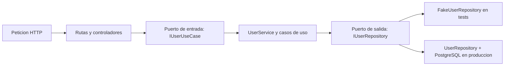

# Guia de estudio de los tests

Esta carpeta contiene los tests de integracion del paquete raiz `backend`.
Cargo compila cada archivo `*_tests.rs` como un consumidor externo de la
libreria. Por eso estos tests sirven para comprobar que las capas se comunican
por sus contratos publicos y no por detalles internos.

El objetivo principal de esta guia es estudiar como la arquitectura hexagonal
permite probar cada capa sin levantar todo el sistema.

Para organizar pruebas por módulos, crates y recorridos completos, consulta el
[plan general de arquitectura de tests](./TEST_ARCHITECTURE_PLAN.md). Incluye
lineamientos de diseño y referencias de backend como crates.io, Lemmy y Kanidm.

La [referencia de tests de aplicaciones UI basada en Warp](./UI_APP_TESTING_WARP.md)
conserva la explicación original y sus diagramas de directorios.

## Mapa mental



Los tests cortan ese flujo en dos lugares:

```text
Tests de application
    user_application_tests
        -> casos de uso / UserService
        -> IUserRepository
        -> FakeUserRepository

Tests de HTTP
    user_http_tests
        -> rutas / controladores
        -> IUserUseCase
        -> FakeUserUseCase
```

Esto demuestra una propiedad importante de la arquitectura hexagonal: HTTP y
PostgreSQL son detalles reemplazables alrededor de la aplicacion.

## Antes de comenzar

Conviene tener claras estas palabras:

- **Puerto:** un `trait` que define lo que una capa necesita o expone.
- **Adaptador:** una implementacion concreta de un puerto.
- **Fake:** implementacion ligera usada durante los tests.
- **Fixture:** dato o dependencia preparado para reutilizarse en varios tests.
- **Caso de uso:** operacion de aplicacion que coordina una accion del negocio.
- **Test de integracion de Cargo:** test ubicado en `tests/` que usa la API
  publica del paquete desde fuera.

Los fakes de este proyecto tambien actuan como `stub` y `spy`:

- Son `stub` porque permiten configurar el resultado que devolveran.
- Son `spy` porque guardan llamadas como `created_records` y `last_get_id`.

No es necesario memorizar esos nombres para entender el flujo.

## Orden recomendado de estudio

No empieces leyendo todos los tests de principio a fin. Sigue este orden y
ejecuta cada grupo antes de avanzar.

### 1. Leer el resumen de la estrategia

Archivo: [`TESTING_LAYER.md`](./TESTING_LAYER.md)

Objetivo:

- Entender por que la mayoria de pruebas no necesita PostgreSQL.
- Diferenciar los tests normales del test opcional con base de datos real.

Debes poder explicar esta frase antes de continuar:

> Application conoce `IUserRepository`, pero no conoce
> `FakeUserRepository` ni PostgreSQL.

### 2. Entender como se comparten las utilidades

Archivo: [`support/mod.rs`](../support/mod.rs)

Objetivo:

- Ver que `support` no es una capa de produccion.
- Entender que solamente agrupa utilidades usadas por los tests.

`mod support;` hace disponible este modulo dentro de cada archivo de test de
integracion.

### 3. Estudiar los datos de prueba

Archivo: [`support/builders.rs`](../support/builders.rs)

Objetivo:

- Identificar la diferencia entre `CreateUserInput`, `StoredUserRecord` y
  `UserOutput`.
- Observar que cada capa trabaja con una representacion distinta del usuario.

Preguntas para comprobar lo aprendido:

1. ¿Por que `CreateUserInput` contiene la contrasena sin hash?
2. ¿Por que `StoredUserRecord` contiene `password_hash`?
3. ¿Por que `UserOutput` no devuelve ninguna contrasena?

### 4. Estudiar primero los puertos y despues los fakes

Lee estos contratos:

1. [`IUserRepository`](../../crates/backend_application/src/user_ports/out/user/user_repository.rs)
2. [`IUserUseCase`](../../crates/backend_application/src/user_ports/in/user_use_case.rs)

Despues lee:

- [`support/fakes.rs`](../support/fakes.rs)

Objetivo:

- Ver que `FakeUserRepository` implementa el puerto de salida
  `IUserRepository`.
- Ver que `FakeUserUseCase` implementa el puerto de entrada `IUserUseCase`.
- Entender que los tests pueden cambiar un adaptador sin cambiar la capa que
  estan probando.

Presta especial atencion a:

- `with_create_result`, `with_list_result` y `with_get_result`: preparan el
  resultado de una dependencia.
- `created_records` y `created_inputs`: permiten comprobar que una llamada
  ocurrio con los datos correctos.
- `last_get_id`: permite comprobar que el identificador cruzo correctamente el
  puerto.
- `Arc<Mutex<...>>`: comparte estado observable entre el test y el fake.

Debes poder responder:

> ¿Que tendria que cambiar en los casos de uso si reemplazamos
> `FakeUserRepository` por PostgreSQL?

La respuesta esperada es: nada, siempre que ambos implementen correctamente
`IUserRepository`.

### 5. Revisar el runtime asincrono de los tests

Archivo: [`support/runtime.rs`](../support/runtime.rs)

Objetivo:

- Entender por que los casos de uso asincronos necesitan un runtime Tokio.
- Reconocer que `block_on` solamente permite ejecutar un `Future` desde un
  test sincrono.

Este archivo no contiene logica del negocio.

### 6. Estudiar application sin HTTP ni base de datos

Archivo: [`user_application_tests.rs`](../user_application_tests.rs)

Ejecutar:

```bash
cargo test -p backend --test user_application_tests
```

Orden interno recomendado:

1. `create_user_hashes_password_before_persisting`
2. `create_user_returns_user_output_from_repository_record`
3. `create_user_propagates_repository_error`
4. Tests de `list_users`
5. Tests de `get_user`
6. `user_service_implements_inbound_port_over_repository_port`

Objetivo:

- Reconocer la estructura preparar, actuar y comprobar.
- Ver como el caso de uso transforma datos antes de llamar al repositorio.
- Comprobar que los errores cruzan el puerto.
- Entender que `UserService` conecta el puerto de entrada con los casos de uso.

Al terminar, recorre manualmente este camino:

```text
CreateUserInput
    -> create_user::execute
    -> hash de password
    -> CreateUserRecord
    -> IUserRepository::create_user
    -> StoredUserRecord
    -> UserOutput
```

### 7. Estudiar HTTP sin application ni PostgreSQL reales

Archivo: [`user_http_tests.rs`](../user_http_tests.rs)

Para seguir una petición `POST /v1/users` función por función, consulta
[`HTTP_POST_USER_FLOW.md`](./HTTP_POST_USER_FLOW.md).

Ejecutar:

```bash
cargo test -p backend --test user_http_tests
```

Orden interno recomendado:

1. `get_users_returns_json_users_without_database`
2. `post_users_creates_user_through_inbound_port`
3. `post_users_rejects_invalid_payload_before_calling_use_case`
4. `post_users_rejects_invalid_json_body`
5. `get_user_returns_one_user_and_passes_uuid_to_use_case`
6. Tests de rutas rechazadas y UUID.

Objetivo:

- Ver que `warp::test` simula una peticion HTTP sin abrir un puerto de red.
- Entender que HTTP depende de `IUserUseCase`, no de `UserService` concreto.
- Comprobar la conversion JSON -> DTO -> input de application.
- Ver que una peticion invalida se detiene antes de llamar al caso de uso.

La comprobacion `fake.created_inputs().is_empty()` es especialmente importante:
demuestra que la frontera HTTP rechazo los datos antes de entrar en
application.

### 8. Estudiar los errores y la inyeccion del servicio

Archivo: [`bootstrap_middleware_tests.rs`](../bootstrap_middleware_tests.rs)

Ejecutar:

```bash
cargo test -p backend --test bootstrap_middleware_tests
```

Objetivo:

- Ver como un error interno se convierte en estado HTTP y JSON.
- Entender como Warp inyecta el servicio en los controladores.
- Diferenciar errores controlados de rutas inexistentes.

Aunque el archivo conserva el nombre `bootstrap_middleware_tests`, lo que
prueba directamente es el middleware HTTP; no valida el arranque completo de
la aplicacion.

### 9. Dejar la base de datos real para el final

Archivo: [`database_integration_tests.rs`](../database_integration_tests.rs)

Por defecto este test se omite deliberadamente. Solo se conecta a PostgreSQL
cuando `RUN_DB_TESTS=true` y existe una configuracion valida.

```bash
RUN_DB_TESTS=true cargo test -p backend --test database_integration_tests
```

Objetivo:

- Diferenciar un test rapido y aislado de un test que depende de
  infraestructura.
- Entender por que los caminos criticos necesitan alguna prueba real, aunque la
  mayoria de la logica se pruebe con fakes.

Importante: actualmente este archivo prueba la conexion y el ping. No prueba
las operaciones reales de crear, listar u obtener usuarios.

## Como leer cualquier test

Para cada test responde estas cinco preguntas:

1. **¿Que comportamiento promete el nombre?**
2. **¿Que datos y dependencias prepara?**
3. **¿Que unidad o capa ejecuta?**
4. **¿Que frontera reemplaza con un fake?**
5. **¿Que resultado o interaccion comprueba?**

Ejemplo:

```text
create_user_hashes_password_before_persisting

Promesa: la contrasena se transforma antes de persistir.
Unidad: caso de uso create_user.
Frontera reemplazada: IUserRepository.
Adaptador de test: FakeUserRepository.
Comprobacion: el record capturado contiene un hash valido y no el texto plano.
```

## ¿Son suficientes los tests actuales?

### Si son suficientes para aprender

Los tests actuales permiten entender correctamente:

- puertos de entrada y salida;
- adaptadores intercambiables;
- inyeccion de dependencias;
- casos de uso aislados de infraestructura;
- controladores aislados de application;
- DTOs diferentes para HTTP, application y persistencia;
- propagacion y traduccion basica de errores;
- diferencia entre tests con fakes y tests con infraestructura real.

Para estudiar el flujo hexagonal actual de `user`, constituyen una buena base.

### No son suficientes para validar todo el backend

Todavia faltan pruebas relevantes para:

1. Las delegaciones `create_user` y `get_user` de `UserService`.
2. Las respuestas HTTP cuando el fake devuelve errores al crear, listar u
   obtener usuarios.
3. Los caminos `415 Unsupported Media Type` y `500 Unhandled rejection`.
4. Los cargadores de configuracion y sus variables ausentes o invalidas.
5. Las consultas reales de `UserDataStore` contra PostgreSQL.
6. El mapeo completo `UserEntity -> StoredUserRecord` usando infraestructura.
7. Los health checks de PostgreSQL, Qdrant y SurrealDB.
8. La composicion de recursos y servicios en bootstrap.
9. Un camino end-to-end que atraviese HTTP, application y PostgreSQL.
10. Los futuros casos de uso del dominio `product`.

El reporte de cobertura es una herramienta para encontrar estos huecos, pero
un porcentaje alto no garantiza por si mismo que los escenarios sean buenos.

Para regenerarlo:

```bash
cargo llvm-cov --workspace --html
```

Reporte local:

```text
target/llvm-cov/html/index.html
```

## Evaluacion arquitectonica actual

La separacion principal es correcta y comprobable:

- HTTP depende del puerto de entrada.
- Application depende del puerto de salida.
- Los tests proporcionan adaptadores controlables para ambos puertos.
- La base de datos real queda fuera de los casos de uso.

Existe un punto que conviene mejorar gradualmente: `CustomError` se comparte
entre capas y contiene variantes como `HttpError` y `DatabaseError`. Esto hace
que application conozca nombres propios de transporte e infraestructura. Una
arquitectura hexagonal mas estricta usaria errores de application o dominio y
los adaptadores traducirian esos errores en ambos bordes:

```text
error de PostgreSQL
    -> error de application/dominio
    -> error HTTP publico
```

No es necesario cambiarlo para estudiar los tests actuales, pero es una buena
evolucion futura para reforzar los limites.

## Siguiente practica recomendada

Despues de completar la lectura, agrega mentalmente o en una rama separada
estos tres escenarios, en este orden:

1. Un test de `UserService::create_user` con `FakeUserRepository`.
2. Un test HTTP donde `FakeUserUseCase::with_get_result` devuelve un error.
3. Un test real de PostgreSQL que inserta y recupera un usuario en un entorno
   de prueba controlado.

Los tres ejercicios recorren progresivamente application, adaptador de entrada
y adaptador de salida.

## Relacion con TDD

Esta estructura facilita TDD, pero no convierte automaticamente el proyecto en
TDD. Para aplicar TDD a una funcionalidad nueva:

1. Escribe un test que describa el nuevo comportamiento.
2. Ejecutalo y confirma que falla por la razon esperada.
3. Implementa el cambio minimo para hacerlo pasar.
4. Refactoriza manteniendo todos los tests en verde.

## Comandos de referencia

```bash
# Todos los tests del paquete raiz
cargo test -p backend

# Un archivo de test concreto
cargo test -p backend --test user_application_tests

# Todo el workspace
cargo test --workspace

# Reporte HTML de cobertura
cargo llvm-cov --workspace --html
```
